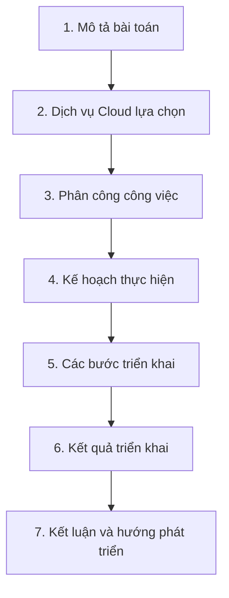

# Hướng dẫn và quy định báo cáo Mini Project

Tài liệu tổng hợp yêu cầu, quy chuẩn trình bày và tiêu chí đánh giá cho hai sản phẩm nộp của Mini Project môn **Triển khai ứng dụng trên Public Cloud**:

- **Báo cáo văn bản** (Document)
- **Thuyết trình và Live Demo** (Presentation)

## Mục lục

- [Thông tin đề tài của nhóm](#thông-tin-đề-tài-của-nhóm)
- [1. Yêu cầu chung](#1-yêu-cầu-chung)
- [2. Lựa chọn và sử dụng dịch vụ Public Cloud](#2-lựa-chọn-và-sử-dụng-dịch-vụ-public-cloud)
- [3. Quy cách và cấu trúc báo cáo](#3-quy-cách-và-cấu-trúc-báo-cáo)
- [4. Thuyết trình và Live Demo](#4-thuyết-trình-và-live-demo)
- [5. Checklist trước khi nộp](#5-checklist-trước-khi-nộp)

---

## Thông tin đề tài của nhóm

### Tên đề tài

**Xây dựng và triển khai nền tảng chatbot AI ChatFrog hỗ trợ hội thoại thông minh và tạo sinh hình ảnh, tích hợp Qwen LLM và Qwen Image Generation trên máy chủ ảo (VPS) ICTU**, sử dụng Namecheap Domain, Cloudflare DNSaaS, MongoDB Atlas DBaaS, Tailscale NaaS và GitHub SaaS.

### Mô tả đề tài

ChatFrog là nền tảng chatbot AI hỗ trợ **trò chuyện thông minh, tạo ảnh, chỉnh sửa ảnh và đọc tài liệu**. Người dùng có thể tùy chỉnh phong cách câu trả lời theo ý muốn.

**Vấn đề cần giải quyết:**

- Chi phí cao khi sử dụng các dịch vụ AI thương mại.
- Nhu cầu bảo mật dữ liệu người dùng.

**Giải pháp:** Thay vì trả phí cho dịch vụ bên ngoài, hệ thống tận dụng GPU RTX 5090 sẵn có để tự vận hành (self-host) mô hình **Qwen 3.6** (LLM) và **Qwen Image 2.1** (tạo/chỉnh sửa ảnh) qua Ollama / llama.cpp. Nhờ đó chi phí vận hành gần như bằng 0 và dữ liệu người dùng được giữ trong hạ tầng nội bộ.

### Dịch vụ sử dụng

| Thành phần       | Dịch vụ              | Mô hình dịch vụ | Vai trò                                  |
| :--------------- | :------------------- | :-------------: | :--------------------------------------- |
| Máy chủ ứng dụng | VPS ICTU             |      IaaS       | Chạy backend, frontend và reverse proxy  |
| Tên miền         | Namecheap            |        —        | Đăng ký domain cho hệ thống              |
| DNS và bảo mật   | Cloudflare           |     DNSaaS      | Phân giải DNS, proxy, chống tấn công     |
| Cơ sở dữ liệu    | MongoDB Atlas        |      DBaaS      | Lưu người dùng, hội thoại, tin nhắn      |
| Mạng riêng       | Tailscale            |      NaaS       | Kết nối bảo mật giữa VPS và máy chủ GPU  |
| Quản lý mã nguồn | GitHub               |      SaaS       | Lưu trữ và quản lý phiên bản source code |
| Model server     | Máy chủ GPU RTX 5090 |    Self-host    | Chạy Qwen LLM và Qwen Image              |

---

## 1. Yêu cầu chung

### 1.1. Phạm vi đề tài

Nhóm chọn một trong các hướng sau:

| Hướng                                        | Ví dụ                                                                                          |
| :------------------------------------------- | :--------------------------------------------------------------------------------------------- |
| **Web Application / E-commerce**             | Website thương mại điện tử, mạng xã hội thu nhỏ, web app quản lý, hệ thống chat thời gian thực |
| **Mobile Application**                       | Ứng dụng di động có backend kết nối qua Internet/API                                           |
| **IoT System**                               | Hệ thống giám sát, thu thập và điều khiển dữ liệu qua mạng                                     |
| **Machine Learning / Deep Learning Service** | API suy luận mô hình, phân loại hình ảnh, chatbot AI                                           |

### 1.2. Độ phức tạp

- **Không chấp nhận đề tài quá đơn giản**, gồm:
  - Trang web tĩnh (HTML/CSS thuần, không có backend).
  - Template dựng sẵn không can thiệp logic.
  - Bài tập cơ bản thiếu chiều sâu.
- **Phải có quy trình phân tích và thiết kế hệ thống**: mô hình dữ liệu, kiến trúc phần mềm, luồng nghiệp vụ và đặc tả API rõ ràng.

### 1.3. Phân chia công việc

- Khối lượng công việc đủ lớn để chia đều, công bằng cho mọi thành viên.
- Mỗi thành viên có vai trò, nhiệm vụ và sản phẩm đầu ra (deliverable) cụ thể, ví dụ: Frontend, Backend, Database, Cloud/DevOps, Testing & Documentation.

---

## 2. Lựa chọn và sử dụng dịch vụ Public Cloud

> [!IMPORTANT]
> Mục tiêu cốt lõi của môn học là nắm vững cách vận hành và triển khai (deploy) một sản phẩm thực tế lên hạ tầng Public Cloud.

### 2.1. Tiêu chí chọn nhà cung cấp

- **Quy mô phù hợp:** Ưu tiên nhà cung cấp có Free Trial, Free Tier hoặc credit cho sinh viên, ví dụ DigitalOcean, Linode/Akamai, Vultr, Render, Railway, Fly.io, Oracle Cloud Free Tier, AWS, GCP.
- **Phù hợp kiến trúc:** Loại dịch vụ (IaaS/VPS, PaaS, Container Service, Managed Database, Object Storage, …) phải tương thích với công nghệ của đề tài.

### 2.2. Kiểm soát chi phí và an toàn tài khoản

**Khi liên kết thẻ thanh toán (Credit/Debit Card):**

- Chỉ dùng thẻ hạn mức thấp, thẻ ảo hoặc thẻ debit có số dư vừa đủ để xác thực.
- Thiết lập **Billing Alert / Budget Limit** ngay sau khi tạo tài khoản.
- **Xóa tài nguyên không dùng** (terminate VM, database, …) sau buổi demo để tránh phát sinh chi phí.

**Khi tham khảo hướng dẫn trên mạng (YouTube, Medium, blog, …):**

- Đọc/xem **hết toàn bộ hướng dẫn** trước khi thực hành.
- Luôn đối chiếu với **tài liệu chính thức** (Official Documentation) của nhà cung cấp để cập nhật thay đổi về giá, giao diện và cấu hình bảo mật (Firewall, Security Group, port).

---

## 3. Quy cách và cấu trúc báo cáo

### 3.1. Quy chuẩn hình thức

| Tiêu chí      | Yêu cầu                                                                                                                   |
| :------------ | :------------------------------------------------------------------------------------------------------------------------ |
| Mẫu trình bày | Theo [mẫu báo cáo chung (Google Docs)](https://docs.google.com/document/d/1EEr5p1hp46VBLuG1wmw51AvIj29QLIkd/edit?tab=t.0) |
| Độ dài        | Khoảng **20 trang A4**, không tính bìa, mục lục và phụ lục                                                                |
| Trình bày     | Bố cục rõ ràng, căn lề chuẩn, font thống nhất, đánh số trang                                                              |
| Hình ảnh      | Có chú thích (caption) và đánh số thứ tự                                                                                  |

### 3.2. Cấu trúc 7 phần

#### Phần 1. Mô tả bài toán

- **Bối cảnh và tính cấp thiết:** Vì sao chọn đề tài? Ứng dụng giải quyết vấn đề gì trong thực tế?
- **Đặc tả hệ thống:**
  - **Input:** dữ liệu người dùng, file upload, request API, tham số cấu hình, …
  - **Output:** giao diện, báo cáo, response JSON, hình ảnh tạo sinh, …
  - **Nghiệp vụ cốt lõi:** luồng xử lý chính, sơ đồ kiến trúc (Architecture Diagram), sơ đồ luồng dữ liệu hoặc Use-case Diagram.

#### Phần 2. Dịch vụ Cloud lựa chọn

- **Thông tin dịch vụ:** nhà cung cấp, loại dịch vụ (IaaS, PaaS, SaaS, Serverless, …), cấu hình tài nguyên (vCPU, RAM, Disk, OS, Network).
- **Giao diện quản lý:** ảnh chụp Console/Dashboard và các tính năng đã dùng (Instance, Firewall/Security Group, Public IP, DNS, Storage, …).
- **Lý do lựa chọn:** phân tích ưu/nhược điểm; vì sao đây là phương án tối ưu về kỹ thuật, chi phí và thời gian triển khai.

#### Phần 3. Phân công công việc

Lập bảng phân công để thể hiện rõ đóng góp của từng thành viên. Tổng tỷ lệ đóng góp của cả nhóm là 100%.

| STT | Họ và tên    | MSSV | Vai trò              | Nhiệm vụ cụ thể                       | Sản phẩm phụ trách           | Đóng góp |
| :-: | :----------- | :--: | :------------------- | :------------------------------------ | :--------------------------- | :------: |
|  1  | Nguyễn Văn A |  …   | Nhóm trưởng / DevOps | Thiết lập Cloud, Docker, Nginx, CI/CD | Hạ tầng, tài liệu triển khai |   34%    |
|  2  | Trần Thị B   |  …   | Backend Developer    | Thiết kế DB, API, tích hợp AI         | Source backend, tài liệu API |   33%    |
|  3  | Lê Văn C     |  …   | Frontend Developer   | Giao diện web, responsive, gọi API    | Source frontend, UI          |   33%    |

#### Phần 4. Kế hoạch thực hiện

Bảng kế hoạch theo mốc thời gian (timeline hoặc Gantt chart), mỗi dòng gồm:

- Bước công việc và nội dung cụ thể.
- Sản phẩm/kết quả đầu ra dự kiến.
- Thời gian bắt đầu và hạn hoàn thành.

#### Phần 5. Hướng dẫn triển khai lên Cloud (Deployment Guide)

> [!NOTE]
> Đây là phần trọng tâm kỹ thuật của báo cáo. Viết dưới dạng **hướng dẫn từng bước (step-by-step)** để người khác có thể làm lại được (reproducible).

1. **Chuẩn bị môi trường:** cài OS, Docker, Docker Compose, runtime (Node.js, Go, Python, …), cấu hình SSH key.
2. **Cấu hình mạng và bảo mật:** mở port firewall (UFW/Security Group: 22, 80, 443, …), cấu hình DNS, cấp chứng chỉ SSL/TLS (Certbot / Let's Encrypt).
3. **Deploy ứng dụng:** clone source code, tạo file `.env`, build container/service, cấu hình reverse proxy (Nginx / Caddy / Traefik).

> [!IMPORTANT]
> Mỗi bước **bắt buộc** có ảnh chụp màn hình terminal hoặc giao diện cấu hình, kèm chú thích rõ ràng.

#### Phần 6. Kết quả triển khai

- **Minh chứng hệ thống đang chạy:** domain hoặc Public IP của sản phẩm trên Cloud.
- **Tính năng và giao diện:** ảnh chụp các màn hình chính (đăng ký/đăng nhập, dashboard, tác vụ nghiệp vụ, tương tác AI, …).
- **Hướng dẫn sử dụng (User Guide):** cách người dùng cuối truy cập và sử dụng hệ thống.

#### Phần 7. Kết luận và hướng phát triển

- **Đánh giá kết quả:** mức độ hoàn thành so với mục tiêu ban đầu.
- **Thuận lợi và khó khăn:** sự cố gặp phải khi làm việc với Cloud (network, memory leak, permission, lỗi deploy, …) và cách khắc phục.
- **Hướng phát triển:** mở rộng tính năng, nâng cấp hạ tầng (CI/CD tự động, monitoring/logging với Prometheus/Grafana, scaling, …).

---

## 4. Thuyết trình và Live Demo

### 4.1. Nội dung slide

Slide ngắn gọn, trực quan, làm rõ **4 nội dung bắt buộc**:

1. **Bài toán:** giải quyết vấn đề gì, cho ai; input, output và hướng giải quyết cốt lõi.
2. **Kiến trúc và triển khai Cloud:** sơ đồ triển khai, dịch vụ Cloud đã dùng, quy trình deploy và cấu hình.
3. **Kết quả đạt được:** tổng quan hệ thống và các chức năng đã hoàn thành.
4. **Kết luận và hướng phát triển:** bài học kinh nghiệm khi vận hành Cloud và định hướng mở rộng.

### 4.2. Yêu cầu Live Demo

**Demo trực tiếp trên Public Cloud:**

- Truy cập hệ thống qua Internet (domain hoặc Public IP thật).
- **Không chấp nhận demo trên `localhost`**, trừ khi giả lập dịch vụ ngoại vi và có lý do chính đáng.
- Thao tác trên Dashboard/Console của nhà cung cấp để chứng minh tài nguyên đang chạy thực tế.

**Thực nghiệm tính năng:**

- Chạy các luồng chức năng chính, gồm cả trường hợp thành công (happy path) và xử lý lỗi (error handling).
- Kiểm tra tốc độ phản hồi và độ ổn định của hệ thống trên môi trường Cloud.

---

## 5. Checklist trước khi nộp

### 5.1. Báo cáo

- [ ] Đúng mẫu quy định, dài khoảng 20 trang A4.
- [ ] Đủ 7 phần theo cấu trúc chuẩn.
- [ ] Bảng phân công có tỷ lệ (%) đóng góp của từng thành viên.
- [ ] Phần 5 có ảnh chụp màn hình minh họa cho từng bước.
- [ ] Có link repository (GitHub/GitLab) và địa chỉ truy cập ứng dụng (URL/IP).
- [ ] Xuất file PDF chất lượng cao; đã kiểm tra chính tả và bố cục hình ảnh.

### 5.2. Thuyết trình và Demo

- [ ] Slide súc tích, làm rõ 4 nội dung bắt buộc.
- [ ] Ứng dụng trên Cloud chạy ổn định; HTTPS/domain sẵn sàng (nếu có).
- [ ] Chuẩn bị tài khoản test có sẵn dữ liệu mẫu.
- [ ] Phân công rõ người thuyết trình và người thao tác demo.
- [ ] **Kế hoạch dự phòng:** quay sẵn video toàn bộ quá trình demo trên Cloud, phòng khi mạng gặp sự cố tại phòng báo cáo.
